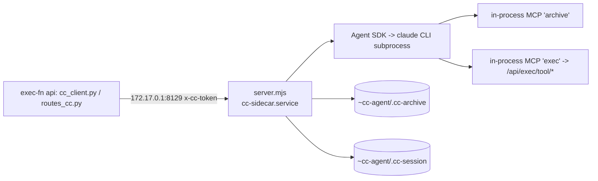

# claude-box — sidecar architecture

The host-side Claude Code sidecar: `server.mjs` on the Agent SDK, run as the unprivileged user `cc-agent` by `cc-sidecar.service`, reached from the exec-fn container over the docker bridge. It is the agent behind the Exec panel (and the `/api/cc/*` routes).

**This file moved from exec-fn's ARCHITECTURE.md §7 on 2026-10-14** (the repo is `wai-lau/cc-sidecar`, a submodule of exec-fn at `claude-box/`). A bare "§N" below means **exec-fn's ARCHITECTURE.md**; "S-N" means a section of THIS file. Each heading names its old exec-fn id (`was §7x`) so old references can be repointed. History / incident stories: [ARCHAEOLOGY.md](ARCHAEOLOGY.md). The parent's side (routes, `cc_client.py` transport, the Exec panel UI, status bar, commands, voice input, owner-only tier) is **§7** in exec-fn.

Verified against the code on 2026-10-14. Counts and names are read from the source, not from older docs; where something could not be checked it says so.

## Map

| File | What |
|---|---|
| `server.mjs` | The HTTP server, `handleQuery`, the sandbox options, the session pointer, history, archive, `/interrupt` |
| `login.mjs` | Signing back in from the panel (S-2) |
| `sandbox-paths.mjs` | The path gate for path-taking tools (S-5) |
| `exec-tools.mjs` | Exec's card tools relayed to the container; fetches Exec's prompt (S-7, S-9) |
| `archive-tools.mjs` | The three archive tools (S-8) |
| `title-gen.mjs` | Rolling title writer + judge (S-12) |
| `uploads.mjs` | Dropped non-image files written into the sandbox (S-13) |
| `usage.mjs` | The 5h / 7d subscription windows (S-14) |
| `probe-tools.mjs` | What tools does the model actually get (S-6) |
| `cc-context.md` | Wai's standing context, half of the system prompt (S-9) |
| `cc-sidecar.service`, `setup.sh`, `exec-fn-ccprobe.cron` | Install: unit, provisioning, nightly probe cron (S-1) |
| `*.test.mjs` | `login`, `sandbox-paths`, `uploads` (13 + 4 + 2 `test(` cases) |

## S-1. Topology and install (was §7a)

Claude Code cannot run in the app container (`python:3.12-slim` — no node, no `claude` binary, no credentials), so it runs on the droplet HOST as its own user and the container reaches it at `172.17.0.1:8129` (`CC_BIND_HOST`/`CC_BIND_PORT`; the container side reads `CC_SIDECAR_URL`). Same idiom as hosaka/emet/printer minus the SSH tunnel. **Never bind 0.0.0.0** — nginx does not proxy this port and that is load-bearing.



**Endpoints** (all need the `x-cc-token` header = `CC_SIDECAR_TOKEN`; 401 otherwise):

| Method | Path | What |
|---|---|---|
| GET | `/health` | `{ok, busy, active, authed}`; `authed` = `~/.claude/.credentials.json` exists, probed per call, advisory only |
| POST | `/query` | `{prompt, images?, files?}` → SSE: `session`, `text`, `thinking`, `tool`, `tool_result`, `done`, `error` (and `limits`, see S-14). A second concurrent run → HTTP 429 `busy` |
| POST | `/interrupt` | Abort the run in flight → `{ok, stopped}` (S-11) |
| POST | `/new` | Archive the current thread, then drop the pointer (S-10) |
| GET | `/history` | `{sessionId, messages}` with `actions` rows (S-10) |
| GET | `/sessions` | `{current, sessions:[{id,title,modified,bytes}]}`, newest first, capped at 200 |
| POST | `/resume` | `{sessionId}` → point the pointer at an existing sandbox session |
| GET | `/title` | The SDK's own `customTitle`/`summary` for the current session |
| POST | `/title-gen` | The written-and-judged rolling title (S-12) |
| GET | `/limits` | Subscription windows (S-14) |

**Auth is `cc-agent`'s OWN subscription login** (`sudo -u cc-agent -H /usr/bin/claude`, then `/login`) — NOT a copy of wai-root's `~/.claude/.credentials.json`. Two processes sharing one OAuth refresh token race, and the loser (usually the interactive session) is logged out mid-refresh. A logged-out sidecar answers a clean per-request `Not logged in · Please run /login` text frame, so the page degrades rather than 500s.

**`MAX_CONCURRENT` 1 + `MemoryMax=700M`** is a memory ceiling expressed as a queue depth (~930MB free, each run spawns a CLI subprocess). Limits in `server.mjs`: `MAX_TURNS` 40, `IDLE_TIMEOUT_MS` 10 min, 4 images x 5MB base64, 24MB body. All overridable by `CC_*` env.

**Install**: `sudo bash /exec-fn/claude-box/setup.sh` — idempotent. Creates `cc-agent`, `/srv/cc-sandbox`, copies **every module `server.mjs` imports** (a missing line once shipped a `server.mjs` whose imports did not exist and the unit would not boot) plus `cc-context.md` into `/srv/cc-agent/`, runs `npm install --omit=dev`, writes `/etc/cc-sidecar.env` once, installs the unit and the probe cron, `daemon-reload`s. It does NOT restart the unit: `sudo systemctl restart cc-sidecar`. `/srv/cc-agent` is **root-owned** so the agent cannot rewrite the server that constrains it. The setup script copies from `/exec-fn/claude-box/`, so the submodule must stay at that path.

## S-2. Signing back in from the panel (`login.mjs`, was §7a-bis)

The login does die: on 2026-10-09 the CLI's OAuth refresh failed and every Exec turn became `Failed to authenticate: OAuth session expired and could not be refreshed`. The ssh fix was miserable from a phone, and the TUI hard-wraps the 465-char URL, which claude.com then rejects as `Invalid request format`. Now the panel recovers it:

1. A turn whose SDK message carries `error: "authentication_failed"` (or that throws something matching `SIGNED_OUT_RE`) makes `handleQuery` call `startLogin()`: spawn `claude auth login --claudeai` (`/usr/bin/claude`; `CC_CLAUDE_BIN` overrides), cut the URL out of its OSC 8 hyperlink.
2. The URL is appended to the failure reply as a markdown link in an ordinary `text` frame — **no page JS changed**.
3. While a sign-in waits, a message shaped `code#state` (or a bare 32+ char code) goes to `answerSignIn` instead of the model — before the busy check, taking no query slot. The code is written to the CLI's stdin; the CLI, holding the PKCE verifier, does the exchange and writes `.credentials.json` itself. The code never enters a transcript. The match runs on the prompt with the `<exec-context>` block stripped.
4. Replies: "Signed back in. Send your last message again." A wrong code gets the CLI's last line plus a fresh link (the CLI exits after one bad exchange); a code from an older link gets "Use this one".

The code cannot come back without a paste: the OAuth client redirects only to `platform.claude.com/oauth/code/callback` or to `localhost` on the clicking machine. The child lives `LOGIN_TTL_MS` (10 min); repeated failures rejoin the same pending sign-in rather than spawning a second CLI in the 700M unit. `startLogin(env)` takes the child's env from the caller (`childEnv()`, token stripped). Tests: `login.test.mjs` (fake CLI), wrapped by exec-fn's `tests/test_cc_login.py`.

## S-3. The sandbox — three mechanisms, NOT equally strong (was §7b)

1. **The filesystem is an ALLOWLIST and is solid**: `TemporaryFileSystem=/:ro` + named `BindReadOnlyPaths`/`BindPaths` in `cc-sidecar.service`. It names `/usr /bin /sbin /lib /lib64 /srv/cc-agent` read-only, a **file-by-file slice of `/etc`** (`ssl`, `ca-certificates`, `ca-certificates.conf`, `passwd`, `group`, `nsswitch.conf`, `hosts`, `localtime`, optional `resolv.conf` and `/run/systemd/resolve`), and read-write only `/srv/cc-sandbox` + `/home/cc-agent`. `ProtectSystem=` is deliberately absent — it conflicts with the tmpfs root and wins, bringing the real root back. `/etc/cron.d`, `/etc/nginx`, `/exec-fn`, `data/` and the docker socket are absent from the namespace.
2. **MCP connectors are an ALLOWLIST and are solid**: `strictMcpConfig: true` + `mcpServers` naming only the two in-process servers (`archive`, and `exec` once its schemas have loaded) = "only the servers named here". A subscription login attaches the ACCOUNT's connectors (Gmail/Calendar/Drive have been live); `strictMcpConfig` is what drops them. Re-probe after enabling a new one.
3. **Tools are an ALLOWLIST**, via the SDK's **`tools`** option: `BUILTIN_TOOLS` is passed as `tools`, so anything not named never enters the model's context, including a tool from a future SDK. `disallowedTools: BLOCKED_TOOLS` stays as belt, to keep built-ins out of context. **`canUseTool` is NOT the gate for harness tools** (measured: a deny-everything callback never saw `ToolSearch`/`CronList`, which both executed) — it is a third layer: it denies names outside `ALLOWED_TOOLS` and applies the path gate (S-5). `ALLOWED_TOOLS` is deliberately NOT passed as the SDK's `allowedTools`, which would auto-approve before `canUseTool` and shadow it.

Also: **`settingSources: []`** (the agent has Write and Bash, so a `settings.json` it wrote would otherwise return as policy), `maxTurns`, `permissionMode: "default"`, and `MemoryMax=700M` (a runaway command kills the sidecar rather than inviting the global OOM killer to pick a victim by badness score, §17b).

**Verify any unit change from INSIDE the namespace** — running as `cc-agent` alone does not test it (`sudo` will not even start in there, which is the confinement working):

```bash
PID=$(systemctl show -p MainPID --value cc-sidecar)
sudo nsenter -t "$PID" -m -S $(id -u cc-agent) -G $(id -g cc-agent) -- \
  env HOME=/home/cc-agent node /srv/cc-agent/probe-tools.mjs
```

The probe authenticates to api.anthropic.com, so it exercises DNS, TLS and OAuth and fails loudly if a bind is missing. (Needs `CC_SIDECAR_TOKEN` in the environment for the exec server to be in the measured sandbox — see S-6.)

**The sandbox stays sealed, by decision** (2026-09-13): no bind for the exec-fn repo, `data/` or the docker socket. If the agent says it cannot find a project, that is correct. `cwd` is `/srv/cc-sandbox`, a private scratch dir, not a checkout; the system prompt says so.

## S-4. The blast radius, honestly (was §7b-bis, 2026-09-13)

With `Bash` + `Read` + `WebFetch` on, the exfiltration path is real: fetched page (or text in a pasted screenshot) → untrusted instructions in context → Bash/Read reach `/home/cc-agent/.claude/.credentials.json` → WebFetch carries it out. `/home/cc-agent` is a **writable** bind and the sidecar runs **as** `cc-agent`, so the OAuth token is readable by the process holding the tools; no mount trick fixes that, the process needs it to authenticate. **Admin-only does not mitigate it** — the trigger is fetched content, not a login.

**Raised, understood and accepted by Wai on 2026-09-13** (worst case: her subscription quota, not infrastructure or data). Do not re-litigate. **Do** re-raise if the credential storage changes, if a larger secret lands in that bind, or if the unit gains a bind reaching the exec-fn repo or `data/`.

## S-5. The path gate, and the one tool it does not cover (`sandbox-paths.mjs`, was §7b-ter)

`canUseTool` confines every **path-taking** tool to the sandbox directory: `Read`, `Write`, `Edit`, `NotebookEdit` (`notebook_path`), `Glob`, `Grep` (`PATH_INPUTS`). The namespace decides what EXISTS; this decides where inside it the agent may go — it still contains `/home/cc-agent`.

**Two checks, and the second is why this is not "a regex":** a character allowlist on the raw string (no NUL, no leading `~`, no `://`), then the **resolved** path must still sit under the root. The resolution is not optional because the agent has `Write`: `ln -s /home/cc-agent/.claude/.credentials.json ./notes.txt` then `Read ./notes.txt` is textually inside the sandbox the whole time. `realpath()` collapses it. A not-yet-existing file (Write creating one) resolves its deepest EXISTING ancestor, since the parent can be the link. Containment compares path **segments**, never a string prefix (`/srv/cc-sandbox-evil`). `SANDBOX_ROOT` is resolved once at startup. A denial reads `outside the sandbox -- Read.file_path: resolves to /etc/passwd, outside the sandbox`.

Tests: `sandbox-paths.test.mjs`, 13 cases against real directories and real symlinks (a mocked `realpath` would be testing the test). Run it by FILE: `node --test claude-box/` treats every `.mjs` in the directory as a test and would execute `server.mjs` (binds a port) and `probe-tools.mjs` (spends a real API call) — so use `node --test *.test.mjs`.

> **`Bash` is NOT covered, and cannot be by this or any regex.** A shell command reaches any path through quoting, variables, subshells or a redirect. **Decided 2026-09-14: keep `Bash`, accept that the sandbox dir binds only the file tools.** Bash's boundary is the mount namespace: it cannot see `/exec-fn`, `data/`, the docker socket, `/etc/cron.d`, `/etc/shadow`, but CAN reach `/home/cc-agent`. Do not re-litigate; do re-raise if a bigger secret lands in that bind.

## S-6. Tools — what is granted (was §7c, sidecar half)

**24 allowed names, one allowlist, all ours**: the 11 built-ins in `BUILTIN_TOOLS` (`Read`, `Write`, `Edit`, `NotebookEdit`, `Bash`, `BashOutput`, `KillShell`, `Glob`, `Grep`, `WebSearch`, `WebFetch`) + the 3 `mcp__archive__*` (`ARCHIVE_TOOL_NAMES`) + the 10 `mcp__exec__*` (`EXEC_TOOL_NAMES`) = `ALLOWED_TOOLS`. Plus an explicit `systemPrompt` replacing Claude Code's coding-CLI preset, `cwd` on the sandbox. **Count from `server.mjs`, never from a doc** — this has been wrong in docs three times (5, 12, 14).

A **cold probe prints 22**: `BashOutput`/`KillShell` surface only once a background shell exists (`CONDITIONAL` in `probe-tools.mjs`), so their absence is not a finding. The direction that matters is `UNEXPECTED` (exit 1). Measured 2026-09-27: 22 tools, no `UNEXPECTED`; **not re-measured in this docs pass** (running it spends an API call and needs the token).

**Run the probe after any `@anthropic-ai/claude-agent-sdk` bump**; it is automatic nightly:

- `scripts/cc-probe-daily.sh` (exec-fn repo, root cron `/etc/cron.d/exec-fn-ccprobe` installed by `setup.sh` from `exec-fn-ccprobe.cron`, 5:20 ET) compares the INSTALLED SDK version (`/srv/cc-agent/node_modules/.../package.json`) against the stamp `/srv/cc-agent/.sdk-probed`. **The trigger is the installed version, not a commit**: `package.json` pins `^0.3.265`, so any `npm install` can pull a new minor with no repo change. Unchanged → one file read, no API call. Exit 1 (a tool outside `ALLOWED_TOOLS`) shouts into `data/cron/…__ccprobe.log` (visible on `/debug`) and **does not stamp**, so it re-reports nightly until fixed; exit 2 (auth/network/SDK shape) is logged as noise. By hand: `sudo /exec-fn/scripts/cc-probe-daily.sh --force`.
- The script sources `/etc/cc-sidecar.env` as root and passes the token with `sudo --preserve-env=CC_SIDECAR_TOKEN,EXEC_API_URL`, never on the command line; without it the exec server is absent and the probe measures a smaller sandbox than the one serving traffic.
- `probe-tools.mjs` imports `sandboxOptions()`/`probeOptions()` and `ALLOWED_TOOLS` from `server.mjs` rather than rebuilding them, so it measures the policy that serves traffic. That is why `server.listen` is guarded by `RUN_AS_MAIN`: an import that seized the port would take the live sidecar down to answer a question about it. The probe runs in `TITLE_SANDBOX` so it never files a session in Wai's picker. (Its header comment still says "TOOL COUNT: 0" — stale text in the code, not fixed here.)

**Deliberately still OUT** (comment in `server.mjs`; each a judgement): `Task` (subagents ~300MB each vs the 700M cap), `AskUserQuestion`/`EnterPlanMode`/`ExitPlanMode` (the page cannot render them), `Skill` (reads a dir not in the namespace), `Cron*`/`Workflow`/`RemoteTrigger`/`PushNotification`/`SendMessage`/`ScheduleWakeup`/`Monitor`/`ListAgents`/`*Worktree`/`DesignSync`/`ReportFindings`/`ToolSearch` (assume a terminal on the other end). Listed in `BLOCKED_TOOLS` as belt.

**The web tools are a deliberate widening**: `WebFetch` is a real exfiltration channel (S-4) and Wai enabled it weighing exactly that (2026-09-11).

**Every `query()` call site must set `tools` explicitly.** There are three (`server.mjs`, `title-gen.mjs`, `probe-tools.mjs`) and nothing enforces it but review. `allowedTools: []` reads like a restriction and is not one (it means "auto-allow these").

**Tool results** cross the relay as `{type:"tool_result", isError, text}`; `resultText()` handles a string, an array of `{type:"text"}` blocks, and structured blocks with no `text` (the web tools' shape) by falling back to the block's JSON, an `[image]` marker instead of base64, and a 20 000-char cap (`RESULT_MAX`). Tool frames carry **no `tool_use_id`** — name + input only — so the page pairs call and result FIFO (parent §7). History replay (`/history?actions`) does pair by id and caps results at 4000 chars.

## S-7. Exec's card tools, relayed to the container (`exec-tools.mjs`, was §7c-bis, 2026-09-27)

The agent gets Exec's ten card tools as `mcp__exec__*` from a second in-process MCP server. The tools stay in Python in the container next to `rd.json` and `_RD_LOCK`; the sidecar only relays — a node copy would be a second copy of every scheduling rule.

- **Two lists.** `EXEC_TOOLS` is the hand-written ALLOWLIST (`create_card`, `archive_card`, `exile_card`, `update_card`, `schedule_card`, `decompose_task`, `advance_chunk`, `record_consequences`, `reschedule_after_consequences`, `update_context`); a tool the container starts serving does not reach the model until someone adds its name. Schemas are fetched from `GET /api/exec/tools` (the container's `chat._chat_tools()`) and converted with zod 4's `z.fromJSONSchema`. A tool is exposed only when in both. Re-read at the start of every run (`refreshExecSchemas`), last good set kept across a failed fetch; the `exec` server is absent until schemas have loaded once. A schema zod cannot read is one missing tool, not a dead server.
- **The call**: `POST /api/exec/tool/{name}` → result JSON as text. A failure comes back as `{error: …}` text, never an exception, so the model reports a failed action instead of claiming it. `CALL_TIMEOUT_MS` is 120 s (a decompose makes an LLM call container-side); schema fetches 3 s.
- **Auth is the sidecar token only** (`x-cc-token` = `CC_SIDECAR_TOKEN`), deliberately not the admin `API_KEY`: the agent has Bash, so anything the sidecar holds must be assumed readable by it. The container-side routes refuse admin/guest creds (parent §7c-bis).
- **The token is stripped from the CLI's environment** (`childEnv()` → the SDK `env` option; also used for the login child). It only needs to live in the node process. Verified live 2026-09-27: `env | grep -c CC_SIDECAR_TOKEN` in the agent's Bash returned 0 while `/proc/<pid>/environ` of the unit held it.
- **Reachability**: the unit has no `PrivateNetwork`, so `127.0.0.1:8080` (the container's published port) is reachable (`EXEC_API_URL` overrides).
- End-to-end check (2026-09-27): a real SDK turn called `mcp__exec__update_card` on a non-existent id and got `{"error":"Card not found: card-doesnotexist"}` back; nothing written.

## S-8. The archive is three tools, not a filesystem (`archive-tools.mjs`, was §7d)

`list_conversations`, `search_conversations`, `read_conversation`, served by an in-process `createSdkMcpServer` named `archive` over `~cc-agent/.cc-archive/`. `/new` had been writing every conversation there while the agent answered "no filesystem, no history store here" — true and useless. **Granting `Read` would have been the lazy fix and the wrong one**: `Read` is a filesystem, and a filesystem is every file the unit can see.

Containment is enforced TWICE per call: the id must match `^[A-Za-z0-9_:-]+$` (no separators or dots, so `..` cannot be spelled) AND the resolved path must still sit under the archive root (the check that survives a future edit to the first). `transcriptPath` is exported for exactly that test. Reads come back in 40K-char slices (`READ_CAP`) with a `from=` offset; search is case-insensitive, 40 hits max; listing is lexical-reverse of the zero-padded stamp = newest first. The system prompt tells it to search the archive rather than claim no memory.

## S-9. The persona is three parts; the board rides in the message (was §7e, sidecar half)

Since phase 2 of the Exec merge (2026-09-28) the agent IS Exec. `buildSystemPrompt()` joins, in order:

1. **Exec's static prompt** — `chat._CHAT_STATIC_PREFIX` from the container, fetched per run from `GET /api/exec/prompt` by `refreshExecPrompt()` (sidecar token only; last good copy kept). **Whether it loaded is logged to the unit's journal on every change**: `journalctl -u cc-sidecar | grep exec-prompt` → `loaded N chars`, or why not (`(agent has NO Exec prompt)` when empty). Do NOT ask the agent to quote its prompt — it confidently quoted one two versions old.
2. `SYSTEM_PROMPT` in `server.mjs` — the page's operating rules (sandbox, archive, web, SVG, what the `<exec-context>` block is). It does not say "You are Claude": Exec's prompt forbids naming Claude and two identities is a coin flip per turn.
3. **`cc-context.md`** — who Wai is and her ADHD calibration. Read from `/srv/cc-agent/cc-context.md` **per run**, so an edit lands with no restart — but **editing the repo copy alone changes nothing**:

```bash
sudo install -o root -g cc-agent -m 0640 claude-box/cc-context.md /srv/cc-agent/
```

Root-owned so the agent cannot rewrite its own instructions. It carries NO repo/project detail, and the personal detail it does carry is safe only while the routes stay owner-only — **if that tier is ever widened, pull this file first.**

**The system prompt must stay byte-stable** or the prefix stops caching: nothing dated or per-board goes in it. Per-turn state rides in the user message as an `<exec-context>…</exec-context>` block that the container prepends (`exec_context.wrap`, parent §7e). The SDK stores it with the turn, so `historyFor()` strips it (`stripExecContext`) — replay, the rolling title and the archive see only what Wai typed. **The tag is a contract**: `exec_context.OPEN/CLOSE` ↔ `CONTEXT_BLOCK` in `exec-tools.mjs`, pinned from the Python side by `tests/test_exec_context.py`.

Testing a prompt change appends to the ONE live conversation: park the pointer first (`sudo mv /home/cc-agent/.cc-session /tmp/cc-session.bak`), restore after.

## S-10. One continuing conversation — the SIDECAR owns the pointer (was §7f, second)

`~cc-agent/.cc-session` holds the current session id, server-side — not a JS variable on the page — so the thread survives a page load, a phone locking, a move between devices. The page never sends a session id; `handleQuery` sets `options.resume` from the pointer, and `rememberSession` writes it when the SDK's `session` frame arrives. Because the pointer IS the thread, resuming (`/resume`) is a one-line change and nothing is copied.

**Clearing ARCHIVES first.** `POST /new` calls `archiveSession()` → `~cc-agent/.cc-archive/<ISO-stamp>__<session-id>/conversation.txt` before dropping the pointer; **a failed archive ABORTS the clear** (HTTP 500 `archive failed: …`, thread kept). Format is fixed and parseable: a `key: value` header (`session`, `archived`, `messages`), a blank line, then one block per message opening `[NNNN] USER|ASSISTANT ISO8601Z`. Index is zero-padded so lexical order IS chronological; timestamps are UTC with a `Z`. Pasted images are written beside it as `img-<NNNN>-<n>.<ext>` with an `images:` line. Dir `0700`, files `0600`, cc-agent — read with `sudo`. An empty history archives nothing and still clears.

`/new` drops the POINTER only: the SDK's transcript stays under `~cc-agent/.claude/projects`. History (`/history`) flattens the stored thread; slash-command turns (`<command-name>` tags) are dropped; an unreadable or vanished session replays as EMPTY rather than erroring; images replay; `?actions` adds one `{role:"action", name, input, result, isError, ts}` row per tool call, paired by `tool_use_id` (the archive uses `actions:false` — its format is fixed).

**Session listing**: every list goes through `sandboxSessions()` = `listSessions({ dir: SANDBOX, limit: 500 })` filtered by `cwd === SANDBOX`. `dir` is load-bearing: `listSessions` is account-wide and its `limit` applies BEFORE any cwd filter, so titler scratch once pushed every real conversation out of the window (2026-09-21, ARCHAEOLOGY). **Any new call must use the helper.** `/resume` re-checks the id is a uuid (it becomes a filename) AND one of the sandbox's own sessions. **Probe and titler runs must not file a conversation**: they run in `TITLE_SANDBOX` (`CC_TITLE_SANDBOX`, default `<sandbox>/.titles`, created at startup) because `/sessions` lists whatever shares the sandbox cwd.

## S-11. A run outlives its caller; interrupt is its own request (was §7k, sidecar half, 2026-10-14)

Wai: "don't stop generating responses when I minimize or close the exec chat." Backgrounding Safari, closing the tab, or the container reloading each dropped the stream, and the old `res.on("close")` abort killed the run with it. Now:

- `handleQuery` sets `running = controller`; a run ends by **finishing, the 10-minute idle timeout (`touch()` per SDK message), or `POST /interrupt`** (aborts `running`; the slot frees when the handler unwinds, so the caller polls `/health`). **There is no `close` listener.** Frames after a hangup are dropped by `sse()` (`res.destroyed`/`writableEnded` checked); the SDK transcript still gets every word, and the page replays from it (parent §7k).
- An orphan holds the single slot until it finishes; a send meanwhile gets HTTP 429 and `cc_client` waits (parent).
- History: the old hangup abort was first wired to `req`, where it never fired (a fully-read `IncomingMessage` emits no further `close`) — see ARCHAEOLOGY. Never reintroduce a hangup abort without reading that and the 2026-10-14 entry.
- Not verified end to end against a live subscription run (needs a message in Wai's real thread); the sidecar half is small (no listener, guarded `sse`, `/interrupt`), and the route was probed live (`{ok, stopped:false}`).

## S-12. Rolling titles — two calls, with a deterministic floor (`title-gen.mjs`, was §7i, sidecar half)

The container's `cc_title.py` caches and schedules; **generation runs here, on the PLAN** (`POST /title-gen`), because Claude Code's own subscription should pay to name a Claude Code conversation. Model `claude-haiku-4-5`. Cost: **~304MB peak and ~6.9s per call** (each spawns a CLI subprocess), so the route is **single-flight AND yields entirely while a chat turn is in flight** (`titleBusy`, separate from `active`; a title must never take the one query slot). Both refusals answer 200 `{title:null, skipped}`, which the container reads as "keep the cached one".

It is **TWO calls**: haiku writes, then an independent haiku call judges whether the title is title-SHAPED and returns one sentence of feedback; the writer gets ONE retry (`MAX_RETRIES` 1 ⇒ ≤4 subprocesses). Input is the latest 12 messages at 400 chars each. A model grading its own output in the same breath talks itself into whatever it just wrote.

**A deterministic floor (`shapeFault`) runs BEFORE the judge**: word count 3-6, trailing punctuation, wrapping quotes, preamble, generic filler, second person, verbatim echo. A measured model judge passed both "Chat Session" and "Sourdough" by quietly writing its own title and grading that. Two more measured rules: the proposed title goes **FIRST** in the judge prompt; the verdict is read with **regex, not `JSON.parse`** (fences, one-element arrays, trailing prose), and **an unreadable verdict PASSES**.

**The titler is a `query()` call site with `tools: []`** (zero tools; once it reached the model with WebSearch/WebFetch via a meaningless `allowedTools: []`), `mcpServers: {}`, `settingSources: []`, one turn, in `TITLE_SANDBOX`. The same loop, floor and parser are duplicated in Wai's statusline hook `~/.claude/hooks/session-recap-gen.js` (runs as wai-root, cannot import from here) — **change one, change the other**.

## S-13. Pictures and dropped files in (was §7l/§7g, sidecar half)

- **Images** arrive in the `/query` body as `{media_type, data}`; `imageBlocks()` keeps ≤ 4 of png/jpeg/gif/webp, ≤ 5MB base64, bare-base64 only, and **drops** a malformed one rather than failing the turn (losing one picture beats losing the message). A string `prompt` cannot carry images, so once there are any the SDK is handed an **async iterable of `SDKUserMessage`** (image blocks + one text block). **An image with no text is a valid message**, so every emptiness check tests prompt, images AND files.
- **Other files** (`uploads.mjs`): up to 4, ≤ ~4.5MB each (6MB base64), written by `saveUploads` into `/srv/cc-sandbox/uploads/<ISO-stamp>-<safe name>` AFTER the busy check (a refused turn writes nothing); the prompt gets `\n\n[attached: uploads/…]` appended so the agent opens them with `Read` — nothing new granted. **The name is the containment**: reduced to `[A-Za-z0-9._-]`, no leading dots, last 80 chars, resolved dir re-checked, `wx` never overwrites, dir `0700`/files `0600`. The panel parses the `[attached: …]` tail back into chips, so the shape is a contract with `web/exec-bubble-msg.js`/`exec-attach.js`. Tests: `uploads.test.mjs`.
- The container caps the same (4 files, 6MB base64 each, 20MB total) under the sidecar's 24MB `readBody` and nginx's 25m.

## S-14. Usage / limits (`usage.mjs`, was §7h, sidecar half)

The status bar's 5h/7d numbers. **They are not in the SDK**: `rate_limit_event` is declared in its `.d.ts` but the string appears ZERO times in the shipped runtime (0.3.265), and nothing the CLI writes to disk holds the numbers. The CLI reads `anthropic-ratelimit-unified-*` headers and calls `GET /api/oauth/usage`; that is reachable outside a request, so `usage()` asks it with cc-agent's OAuth access token and returns `{ok, five_hour, seven_day, seven_day_opus}` as `{pct, resetsAt (epoch s)}`. **The token never leaves the sidecar** and is **never refreshed here** (two processes on one refresh token race; an expired token degrades to `{ok:false}`). Cached 60 s. `normalize()` still forwards a `limits` frame if a future SDK emits `rate_limit_event` — a free upgrade path, today dead.

`done` frames carry `ctxTokens` = input + cache_read + cache_creation of the last `result`, `outTokens`, `turns`, `ms`, `costUsd` (an equivalent-cost estimate on subscription runs, not a charge). **A multi-call turn's `ctxTokens` is the SUM across its API calls**, so ctx% can read 100% after a tool-using turn (measured 2026-09-29: 133K real on a 200K window); the parent shows what the sidecar reports.

## S-15. Ops cheat sheet

```bash
sudo systemctl status cc-sidecar
sudo journalctl -u cc-sidecar -f
sudo bash /exec-fn/claude-box/setup.sh      # reinstall code + cc-context.md + unit + cron
sudo systemctl restart cc-sidecar           # after server.mjs changes
TOK=$(sudo grep -oP '(?<=^CC_SIDECAR_TOKEN=).*' /etc/cc-sidecar.env)
curl -sN -H "x-cc-token: $TOK" -H 'content-type: application/json' \
  -d '{"prompt":"reply with exactly: PONG"}' http://172.17.0.1:8129/query
```

Subscription rate limits are **per account** — sidecar traffic shares the budget of every interactive `claude` session on this box.
